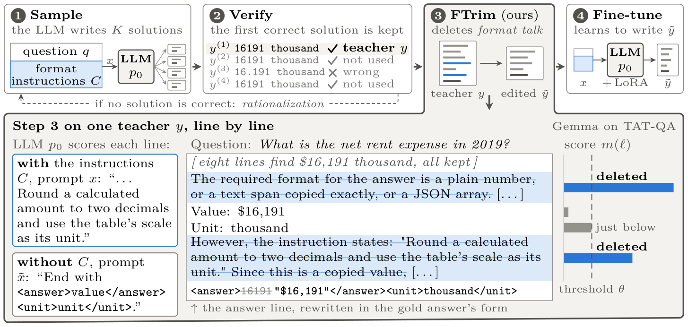

<h1 align="center">FTrim: Format-Talk Trimming</h1>

<p align="center">
  Code and results of the paper<br>
  <b>Trimming Answer-Format Discussion from LLM Self-Training Data with Counterfactual Prompts</b>
</p>

<p align="center">
  
</p>

Self-training fine-tunes a language model on its own solutions with a verified final answer. With detailed format
instructions in the prompt, the solutions often discuss the format rules. We call this *format talk*. It appears in
30–67 % of the test outputs of the untrained models. FTrim deletes format talk from the training solutions and finds
it with a counterfactual prompt that has only the answer tags.

## Method

FTrim edits each kept solution, a *teacher* $y$, before fine-tuning (lines 6 to 8 of Algorithm 1 in the paper).
Sampling, verification and fine-tuning are unchanged.

1. **Answer normalization.** The answer becomes the gold answer in the form of the format instructions, if the
   verifier accepts the result.
2. **Format-talk deletion.** The untrained model $p_0$ scores each reasoning line $\ell$ twice: after the prompt $x$
   with the format instructions and after the counterfactual prompt $\tilde{x}$. The line is deleted if its score
   reaches $\theta = 1$ bit, so the instructions make it at least twice as likely per token on average.
3. **Check.** If the edited teacher fails the verifier, FTrim keeps the unedited teacher (1 of 41,374 teachers).

```math
c_t=\log_2\frac{p_0(y_t\mid x,\,y_{\lt t})}{p_0(y_t\mid \tilde{x},\,y_{\lt t})},\qquad
m(\ell)=\frac{1}{|\ell|}\sum_{t\in\ell}c_t,\qquad\text{delete } \ell \text{ if } m(\ell)\ge \theta .
```

The scoring needs two forward passes per teacher, 1.4 % of the GPU time of the runs in Table 1
([compute](docs/REPRODUCTION.md#compute)).

## Paper and repository

| Paper | Repository |
|:--|:--|
| Table 1 | [Results](#results) below |
| Prompts with $C$ and $\tilde{C}$ (Sect. 3) | [`src/ftrim/prompts.py`](src/ftrim/prompts.py); one question in [`examples/tatqa_example.json`](examples/tatqa_example.json) |
| Target accuracy: strict exact match (Sect. 3) | [Evaluators](docs/DATA.md#evaluators) |
| Other thresholds (Sect. 3) | [Results](#results) below; each setting in [Threshold](results/RESULTS.md#threshold) |
| Intervals and the last answer tag (Sect. 4) | [Gains of FTrim](results/RESULTS.md#gains-of-ftrim) |
| What FTrim deletes (Sect. 5) | [What FTrim deletes](results/RESULTS.md#what-ftrim-deletes) |
| What the models learn, Fig. 2 (Sect. 5) | [What the models learn](results/RESULTS.md#what-the-models-learn) |
| Simple answer formats (Sect. 5) | [Simple answer formats](results/RESULTS.md#simple-answer-formats) |
| Numbers of the paper | `python -m ftrim report --check` ([`src/ftrim/paper.py`](src/ftrim/paper.py)) |

## Results

Qwen3.5-4B and Gemma-4-E4B-it are fine-tuned with LoRA on TAT-QA or DROP, which gives four *settings*. A fine-tuned
row is the mean ± sample standard deviation of three seeds, and an untrained row is a single run.
[`results/RESULTS.md`](results/RESULTS.md) has these tables and the analysis of Sect. 5 of the paper.

**Target accuracy.** Strict exact match (%) on the test set of the target task. *Tokens*: mean output length on this
test set, over the four settings. Bold: best self-training row.

<!-- results:target -->

| Method | Qwen-TAT | Qwen-DROP | Gemma-TAT | Gemma-DROP | Mean | Tokens |
|:--|--:|--:|--:|--:|--:|--:|
| Untrained | 62.06 | 84.38 | 57.37 | 82.30 | 71.52 | 426 |
| + Thinking mode | 72.16 | 86.87 | 61.15 | 80.58 | 75.19 | 2459 |
| SFT on gold answers | 74.40 ±0.40 | 80.62 ±0.13 | 63.32 ±0.06 | 77.22 ±0.30 | 73.89 | 17 |
| Rejection sampling | 70.35 ±0.52 | 86.40 ±0.23 | 61.35 ±0.38 | 82.96 ±0.08 | 75.27 | 391 |
| + Rationalization | 72.34 ±0.16 | 86.44 ±0.05 | 66.93 ±0.74 | 84.05 ±0.20 | 77.44 | 364 |
| Random deletion | 72.60 ±0.51 | 86.43 ±0.12 | 67.13 ±0.28 | 84.46 ±0.06 | 77.66 | 341 |
| STM | 71.50 ±0.26 | 86.55 ±0.12 | 67.11 ±0.47 | 83.37 ±0.17 | 77.13 | 380 |
| **FTrim (ours)** | **76.09 ±0.43** | **86.71 ±0.26** | **69.91 ±0.47** | **84.70 ±0.05** | **79.35** | **326** |

<!-- /results:target -->

**Generalization accuracy.** Mean accuracy (%) on FinanceReasoning, GSM8K, IFEval and ARC-Challenge, which are never
used for training or selection. The first row is the accuracy of the untrained model, and the other rows are the
change from it.

<!-- results:generalization -->

| Method | Qwen-TAT | Qwen-DROP | Gemma-TAT | Gemma-DROP |
|:--|--:|--:|--:|--:|
| Untrained (accuracy) | 87.26 | 87.26 | 87.76 | 87.76 |
| + Thinking mode | +3.26 | +3.26 | +0.19 | +0.19 |
| SFT on gold answers | -27.82 ±0.24 | -30.11 ±0.27 | -15.61 ±0.35 | -33.37 ±0.28 |
| Rejection sampling | +0.09 ±0.21 | -0.58 ±0.12 | -0.21 ±0.19 | -0.27 ±0.31 |
| + Rationalization | -0.23 ±0.08 | -0.49 ±0.27 | -0.48 ±0.31 | -0.34 ±0.24 |
| Random deletion | -0.27 ±0.28 | -0.59 ±0.31 | -0.61 ±0.10 | -1.02 ±0.34 |
| STM | -0.26 ±0.19 | -0.29 ±0.32 | -0.44 ±0.25 | -0.56 ±0.19 |
| **FTrim (ours)** | +0.48 ±0.14 | -0.21 ±0.19 | -0.21 ±0.26 | -0.82 ±0.08 |

<!-- /results:generalization -->

Every self-training row stays within 1.02 points of the untrained model, and FTrim loses at most 0.82 points. SFT
answers without reasoning and loses 15.61–33.37 points.

**Gains of FTrim.** Differences in target accuracy (points). *Pooled*: mean of the four settings with its 95 %
bootstrap interval.

<!-- results:gains -->

| Difference (points) | Qwen-TAT | Qwen-DROP | Gemma-TAT | Gemma-DROP | Pooled |
|:--|--:|--:|--:|--:|--:|
| FTrim − rationalization | +3.75 | +0.27 | +2.99 | +0.65 | +1.91 [+1.36, +2.48] |
| FTrim − random deletion | +3.49 | +0.28 | +2.79 | +0.24 | +1.70 [+1.13, +2.28] |
| FTrim − STM | +4.59 | +0.16 | +2.81 | +1.33 | +2.22 [+1.66, +2.80] |

<!-- /results:gains -->

**Threshold.** FTrim deletes a reasoning line if its score reaches $\theta$. Each threshold has one run with seed
17, and the values are means of the four settings. A *format word* is a word such as format, unit, digit or round
([list](results/RESULTS.md#what-ftrim-deletes)).

<!-- results:threshold -->

| Threshold θ | Reasoning tokens deleted (%) | Deleted lines with format words (%) | Target accuracy | Generalization accuracy | Tokens |
|:--|--:|--:|--:|--:|--:|
| 0 bits (m > 0) | 79.8 | 12 | 73.81 | 75.32 | 204 |
| ½ bit | 10.8 | 56 | 79.29 | 86.96 | 301 |
| **1 bit (FTrim)** | 7.1 | 75 | 79.13 | 87.42 | 323 |
| 2 bits | 2.8 | 90 | 78.75 | 87.26 | 335 |

<!-- /results:threshold -->

Half a bit and two bits change the target accuracy by less than half a point, and half a bit deletes more lines
without format words. A threshold of zero deletes most of the reasoning, and more than half of the test answers then
have no reasoning.

**Notes.**

* *+ Thinking mode* is the untrained model with thinking on: one sample per question with the sampling settings of
  its model card (`thinking_sampling` in `configs/experiment.yaml`), at most 16,384 new tokens. Every other
  evaluation uses greedy decoding without thinking.
* Rejection sampling (Yuan et al., 2023), + Rationalization (STaR, Zelikman et al., 2022) and STM (Wu et al., 2025)
  are prior methods. Every method runs for one round. Random deletion and STM start from the rationalization
  teachers, without the normalization. For each teacher that FTrim edits, random deletion deletes random lines
  among those that FTrim keeps, about as many tokens as FTrim deletes. STM keeps every line and leaves the
  reasoning tokens with perplexity above 2.5 under the untrained model out of the loss.
* Strict exact match: the output ends with exactly one answer tag, and the official evaluator scores its content. On
  TAT-QA the tag must follow the grammar of the instructions, with a unit that maps to a TAT-QA scale. On DROP only
  the tag structure is checked ([details](docs/DATA.md#evaluators)).

## Usage

Python 3.12 with [uv](https://docs.astral.sh/uv/):

```bash
uv sync                                       # CPU: the rule, the scorers, the statistics and the tables
uv run python -m ftrim report --check         # every table from results/, compared with the paper (a few minutes)
uv sync --extra gpu --extra ifeval            # GPU: generation, scoring, fine-tuning and evaluation
uv run python examples/ftrim_one_solution.py  # FTrim on the teacher of Fig. 1: deletes 2 of 12 lines (one 24 GB GPU)
```

[`src/ftrim/core.py`](src/ftrim/core.py) has the rule in numpy. [`docs/REPRODUCTION.md`](docs/REPRODUCTION.md) has
the commands for every experiment. Another task needs format instructions and a counterfactual prompt
([`prompts.py`](src/ftrim/prompts.py)), a verifier ([`scoring.py`](src/ftrim/scoring.py)) and the gold answer in the
form of the instructions (`gold_line` in [`teachers.py`](src/ftrim/teachers.py)).

```
configs/experiment.yaml   every setting of the experiments
src/ftrim/                the method (core.py), prompts, scorers, pipeline, statistics, tables, paper.py
results/                  the tables (RESULTS.md) and the per-question results of the paper's runs
docs/                     REPRODUCTION.md, DATA.md (sources, splits, scoring, licenses)
examples/ scripts/ tests/ FTrim on one solution; figures and generated tables; CPU tests
```

## License

The code is under the [MIT license](LICENSE). The vendored official evaluators keep their licenses
([`NOTICE.md`](src/ftrim/vendor/NOTICE.md)). No dataset is redistributed, apart from one TAT-QA question (CC BY 4.0)
in the example and the figure. [`docs/DATA.md`](docs/DATA.md) lists the sources and licenses.

## Citation

```bibtex
@misc{ftrim2026,
  title  = {Trimming Answer-Format Discussion from {LLM} Self-Training Data with Counterfactual Prompts},
  author = {Ito, Tatsuto and Ozaki, Ryota and Imajo, Kentaro and Hirano, Masanori and Sakaji, Hiroki and Noda, Itsuki},
  year   = {2026},
  note   = {Under review}
}
```
