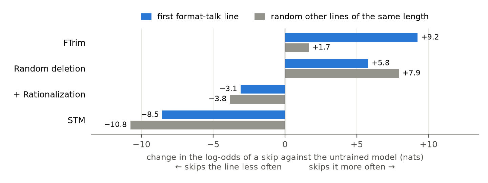

# Results

Generated by `python -m ftrim report` from the per-question results in `results/per_question/`. Do not edit by hand.

A *setting* is one model fine-tuned on one target task: Qwen3.5-4B or Gemma-4-E4B-it on TAT-QA or DROP (Qwen-TAT, Qwen-DROP, Gemma-TAT, Gemma-DROP). *Target accuracy* is the strict exact match on the test set of the target task. *Generalization accuracy* is the mean accuracy on FinanceReasoning, GSM8K, IFEval and ARC-Challenge, which are never used for training or selection. docs/DATA.md defines both. All values are percentages unless noted. Fine-tuned methods are means over the seeds 17, 42 and 89; the untrained rows are one run. Evaluation uses greedy decoding, except the thinking mode: one sample per question with the sampling settings of the model card.

`tables.json` holds these numbers and more: every seed, each generalization benchmark and the statistics of the outputs.

## Target accuracy

Table 1 of the paper, target tasks. Mean ± sample standard deviation over the seeds. *Mean*: mean of the four settings. *Tokens*: mean output length on the target test set, mean of the four settings (thinking mode: the thinking included). Bold: best self-training row.

| Method | Qwen-TAT | Qwen-DROP | Gemma-TAT | Gemma-DROP | Mean | Tokens |
|:--|--:|--:|--:|--:|--:|--:|
| Untrained | 62.06 | 84.38 | 57.37 | 82.30 | 71.52 | 426 |
| + Thinking mode | 72.16 | 86.87 | 61.15 | 80.58 | 75.19 | 2459 |
| SFT on gold answers | 74.40 ±0.40 | 80.62 ±0.13 | 63.32 ±0.06 | 77.22 ±0.30 | 73.89 | 17 |
| Rejection sampling | 70.35 ±0.52 | 86.40 ±0.23 | 61.35 ±0.38 | 82.96 ±0.08 | 75.27 | 391 |
| + Rationalization | 72.34 ±0.16 | 86.44 ±0.05 | 66.93 ±0.74 | 84.05 ±0.20 | 77.44 | 364 |
| Random deletion | 72.60 ±0.51 | 86.43 ±0.12 | 67.13 ±0.28 | 84.46 ±0.06 | 77.66 | 341 |
| STM | 71.50 ±0.26 | 86.55 ±0.12 | 67.11 ±0.47 | 83.37 ±0.17 | 77.13 | 380 |
| **FTrim (ours)** | **76.09 ±0.43** | **86.71 ±0.26** | **69.91 ±0.47** | **84.70 ±0.05** | **79.35** | **326** |

## Generalization accuracy

Table 1 of the paper, generalization benchmarks. The first row is the accuracy of the untrained model. The other rows are the change from it, ± the sample standard deviation over the seeds.

| Method | Qwen-TAT | Qwen-DROP | Gemma-TAT | Gemma-DROP |
|:--|--:|--:|--:|--:|
| Untrained (accuracy) | 87.26 | 87.26 | 87.76 | 87.76 |
| + Thinking mode | +3.26 | +3.26 | +0.19 | +0.19 |
| SFT on gold answers | -27.82 ±0.24 | -30.11 ±0.27 | -15.61 ±0.35 | -33.37 ±0.28 |
| Rejection sampling | +0.09 ±0.21 | -0.58 ±0.12 | -0.21 ±0.19 | -0.27 ±0.31 |
| + Rationalization | -0.23 ±0.08 | -0.49 ±0.27 | -0.48 ±0.31 | -0.34 ±0.24 |
| Random deletion | -0.27 ±0.28 | -0.59 ±0.31 | -0.61 ±0.10 | -1.02 ±0.34 |
| STM | -0.26 ±0.19 | -0.29 ±0.32 | -0.44 ±0.25 | -0.56 ±0.19 |
| **FTrim (ours)** | +0.48 ±0.14 | -0.21 ±0.19 | -0.21 ±0.26 | -0.82 ±0.08 |

## Gains of FTrim

Differences in target accuracy, in points. *Pooled*: the mean of the four settings, with the 95 % interval of 20,000 bootstrap samples over the seeds and over the tables or passages of the test set (`src/ftrim/stats.py`). *Last answer tag only*: the pooled difference when the output is cut at its last answer tag before scoring (last-tag EM in docs/DATA.md). *Generalization accuracy*: the pooled difference on the generalization benchmarks.

| Difference (points) | Qwen-TAT | Qwen-DROP | Gemma-TAT | Gemma-DROP | Pooled | Last answer tag only | Generalization accuracy |
|:--|--:|--:|--:|--:|--:|--:|--:|
| FTrim − rationalization | +3.75 | +0.27 | +2.99 | +0.65 | +1.91 [+1.36, +2.48] | +1.68 [+1.13, +2.24] | +0.19 [-0.11, +0.48] |
| FTrim − random deletion | +3.49 | +0.28 | +2.79 | +0.24 | +1.70 [+1.13, +2.28] | +1.59 [+1.01, +2.17] | +0.43 [+0.11, +0.76] |
| FTrim − STM | +4.59 | +0.16 | +2.81 | +1.33 | +2.22 [+1.66, +2.80] | +1.82 [+1.25, +2.40] | +0.19 [-0.13, +0.52] |
| Random deletion − rationalization | +0.26 | -0.01 | +0.20 | +0.41 | +0.21 [-0.26, +0.68] | +0.10 [-0.39, +0.57] | -0.24 [-0.59, +0.09] |

## Threshold

FTrim deletes a reasoning line when its score m reaches the threshold θ. The paper uses 1 bit. Each threshold has one run with seed 17, so the row of 1 bit is the run of FTrim with this seed. *Reasoning tokens deleted*: share of the reasoning tokens of the teachers. *Deleted lines with format words*: see "What FTrim deletes".

| Threshold θ |  | Qwen-TAT | Qwen-DROP | Gemma-TAT | Gemma-DROP | Mean |
|:--|:--|--:|--:|--:|--:|--:|
| 0 bits (m > 0) | Reasoning tokens deleted (%) | 81.5 | 82.0 | 78.3 | 77.6 | 79.8 |
|  | Deleted lines with format words (%) | 24 | 3 | 13 | 8 | 12 |
|  | Target accuracy | 74.14 | 76.48 | 67.77 | 76.87 | 73.81 |
|  | Generalization accuracy | 80.05 | 56.78 | 83.40 | 81.06 | 75.32 |
| ½ bit | Reasoning tokens deleted (%) | 18.4 | 4.1 | 12.4 | 8.2 | 10.8 |
|  | Deleted lines with format words (%) | 78 | 31 | 59 | 55 | 56 |
|  | Target accuracy | 76.19 | 86.69 | 69.75 | 84.53 | 79.29 |
|  | Generalization accuracy | 87.34 | 86.77 | 87.13 | 86.61 | 86.96 |
| **1 bit (FTrim)** | Reasoning tokens deleted (%) | 13.0 | 2.1 | 7.1 | 6.0 | 7.1 |
|  | Deleted lines with format words (%) | 90 | 55 | 79 | 77 | 75 |
|  | Target accuracy | 75.71 | 86.72 | 69.39 | 84.69 | 79.13 |
|  | Generalization accuracy | 87.90 | 86.95 | 87.85 | 86.97 | 87.42 |
| 2 bits | Reasoning tokens deleted (%) | 3.6 | 0.9 | 2.5 | 4.1 | 2.8 |
|  | Deleted lines with format words (%) | 94 | 79 | 92 | 95 | 90 |
|  | Target accuracy | 74.50 | 86.86 | 68.85 | 84.79 | 78.75 |
|  | Generalization accuracy | 87.54 | 87.32 | 87.01 | 87.16 | 87.26 |

## Normalization only

FTrim normalizes the answer and deletes format talk. *Normalization only* fine-tunes on the normalized teachers without any deletion, with the same seeds. Random deletion and STM edit the rationalization teachers, without the normalization.

| Fine-tuned on | Qwen-TAT | Qwen-DROP | Gemma-TAT | Gemma-DROP | Mean | Tokens |
|:--|--:|--:|--:|--:|--:|--:|
| + Rationalization | 72.34 | 86.44 | 66.93 | 84.05 | 77.44 | 364 |
| Normalization only | 74.62 | 86.45 | 69.37 | 84.30 | 78.69 | 363 |
| **FTrim**: normalization and format-talk deletion | 76.09 | 86.71 | 69.91 | 84.70 | 79.35 | 326 |

| Difference (points) | Qwen-TAT | Qwen-DROP | Gemma-TAT | Gemma-DROP | Pooled |
|:--|--:|--:|--:|--:|--:|
| FTrim − normalization only | +1.46 | +0.26 | +0.54 | +0.40 | +0.67 [+0.22, +1.11] |
| Normalization only − rationalization | +2.29 | +0.00 | +2.45 | +0.25 | +1.25 [+0.73, +1.79] |

## What FTrim deletes

A *format word* is format, unit, scale, digit, JSON, array, instruction, required, rule, verbatim, decimal, round or tag as a whole word, also in plural or verb forms, or `<answer>`, "answer tag", "word for word" or "day month year" (`FORMAT_WORDS` in `src/ftrim/results.py`). FTrim does not use these words. They only describe the lines that its rule selects.

|  | Qwen-TAT | Qwen-DROP | Gemma-TAT | Gemma-DROP |
|:--|--:|--:|--:|--:|
| FTrim: reasoning tokens deleted (%) | 13.0 | 2.1 | 7.1 | 6.0 |
| FTrim: deleted lines with format words (%) | 90 | 55 | 79 | 77 |
| Random deletion: reasoning tokens deleted (%) | 13.4 | 2.3 | 7.8 | 6.6 |
| Random deletion: deleted lines with format words (%) | 20 | 3 | 6 | 1 |
| All reasoning lines with format words (%) | 19 | 3 | 10 | 6 |

The lines that FTrim deletes most often, with numbers replaced by N and the share of the edited teachers that contain the line:

* Qwen-TAT: `round to two decimals:` 9.1 %; `format the answer:` 1.5 %; `determine the unit:` 1.2 %
* Qwen-DROP: `the question asks for a number in digits only.` 7.3 %; `format the answer:` 6.4 %; `the result is N.` 5.3 %
* Gemma-TAT: `round to two decimal places:` 9.3 %; `round the result to two decimal places.` 5.8 %; `format the answer:` 3.9 %
* Gemma-DROP: `format the answer according to the instructions (a number in digits on` 11.9 %; `format the answer according to the instructions.` 10.1 %; `format the answer as a number in digits only.` 5.1 %

FTrim keeps a teacher unedited when the edited teacher fails the check of line 8 of Algorithm 1 (exactly one answer marker, and the verifier accepts): 1 of 41,374 teachers.

## What the models learn

Sect. 5 and Fig. 2 of the paper. Format talk in the test outputs of the untrained models, found with FTrim's rule:

| Test outputs of the untrained model | Qwen-TAT | Qwen-DROP | Gemma-TAT | Gemma-DROP |
|:--|--:|--:|--:|--:|
| Outputs with format talk (%) | 65 | 30 | 52 | 67 |
| Reasoning tokens in format talk (%) | 10.6 | 2.9 | 6.0 | 7.2 |

The fine-tuned models score these outputs three times: as written, without their format-talk lines, and without random other lines of the same length. All such outputs are used on TAT-QA, and a seeded random sample on DROP (Qwen-TAT 1,081, Qwen-DROP 2,000, Gemma-TAT 865, Gemma-DROP 2,000). The table gives the change against the untrained model for the models with seed 17, as the mean of the settings, in nats. *Log-likelihood*: of a whole line. *Skip*: the log-odds that the model writes the token after a line instead of the line's first token.

  

| Fine-tuned with | Log-likelihood of a format-talk line | Log-likelihood of another line | Skip of format talk | Skip of random lines |
|:--|--:|--:|--:|--:|
| + Rationalization | +2.5 | +0.9 | -3.1 | -3.8 |
| Random deletion | +1.6 | +0.4 | +5.8 | +7.9 |
| STM | +4.3 | +1.5 | -8.5 | -10.8 |
| **FTrim (ours)** | -1.2 | +0.7 | +9.2 | +1.7 |

The models with seed 42 agree with these values within 0.3 nats.

## Simple answer formats

Format talk is rarer when the answer is a single number, expression or option. This repository scores the teachers of such datasets only, with the threshold of 1 bit, and TAT-QA with the same model is given for comparison.

| Model | Dataset | Teachers | Reasoning tokens that FTrim deletes (%) | Teachers with a deleted line (%) |
|:--|:--|--:|--:|--:|
| Qwen3.5-4B | MATH | 6,581 | 0.21 | 17.4 |
| Qwen3.5-4B | GSM8K | 6,787 | 0.97 | 26.9 |
| Qwen3.5-4B | MedCalc-Bench | 8,334 | 1.01 | 18.4 |
| Qwen3.5-4B | MedQA | 9,963 | 0.01 | 0.4 |
| Qwen3.5-4B | TAT-QA (Table 1) | 11,982 | 13.05 | 60.4 |
| Gemma-4-E4B-it | MedCalc-Bench | 6,550 | 3.03 | 43.6 |
| Gemma-4-E4B-it | TAT-QA (Table 1) | 11,714 | 7.10 | 55.9 |

## Scoring of the TAT-QA units

The paper's runs count an answer as wrong if its unit is one of the five allowed units without a TAT-QA scale: `ratio`, `percentage_point`, `basis_point`, `hundred` and `trillion` (docs/DATA.md, "Evaluators"). *Units mapped* scores the same test outputs with `ratio` read as no scale and `percentage_point` as percent, as the official evaluator reads these names. Pooled differences:

| Difference (points) | Target accuracy | Target accuracy, units mapped | Last answer tag only | Last answer tag only, units mapped |
|:--|--:|--:|--:|--:|
| FTrim − rationalization | +1.91 [+1.36, +2.48] | +1.74 [+1.20, +2.29] | +1.68 [+1.13, +2.24] | +1.51 [+0.97, +2.05] |
| FTrim − random deletion | +1.70 [+1.13, +2.28] | +1.50 [+0.95, +2.07] | +1.59 [+1.01, +2.17] | +1.39 [+0.83, +1.97] |
| FTrim − STM | +2.22 [+1.66, +2.80] | +1.97 [+1.41, +2.53] | +1.82 [+1.25, +2.40] | +1.57 [+1.00, +2.13] |

With the units mapped, FTrim has the highest target accuracy of the self-training rows in 4 of 4 settings.
